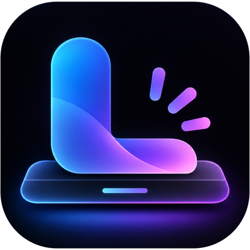

<div align="center">



<h1>Luma Dock</h1>

<p>Uma dock leve e bonita para o GNOME, feita para deixar a área de trabalho do seu jeito.</p>

<a href="metadata.json"></a>
<a href="LICENSE"></a>

<p>
<a href="#instalação"><b>Instalar</b></a> &nbsp;·&nbsp;
<a href="https://github.com/viniciusbispo19/luma-dock/issues"><b>Reportar um problema</b></a>
</p>

</div>

A Luma Dock é uma dock para o GNOME Shell que você molda do seu jeito. Deixe ela flutuando, estique de uma borda à outra ou transforme num painel completo, com áreas de trabalho, bandeja, Configurações Rápidas e relógio, tudo numa barra só.

<br>

## Destaques

- **Interface toda em português do Brasil.**
- **Sem flash do dash do GNOME no login.** A Luma é carregada antes das outras extensões, então a dock do GNOME não aparece por um instante antes dela.
- **Animação "Padrão do GNOME" ao minimizar**, que leva a janela até o ícone dela na dock, e não para o canto da tela.
- **Separador ao lado do Music Pill**, que só aparece enquanto uma música está tocando.
- **Janelas Ocultas:** avisos que alguns apps abrem como janelas comuns (como o indicador de Caps Lock do OpenLogi) não aparecem mais como ícone extra na dock. A lista pode ser editada nas Preferências.

<br>

## Recursos

<details>
<summary><b>Dock e layout</b></summary>
<br>

- Em qualquer borda da tela, em um monitor ou em todos.
- Dock flutuante, barra de largura total ou Dock Independente, com apps fixados e grade de apps próprios.
- Temas, gradientes, bordas e o tema Cor do Papel de Parede, que acompanha o estilo claro ou escuro.
- Desfoque de verdade atrás da dock e dos menus, sem faixas em papéis de parede escuros.
- Indicadores de apps abertos em pontos, linhas ou barras no estilo do Windows.
- Emblemas de notificação nos ícones.

</details>

<details>
<summary><b>Modo Painel</b></summary>
<br>

- Transforma a dock num painel que substitui a barra superior do GNOME.
- Indicador de áreas de trabalho, Configurações Rápidas, data e bandeja ficam direto na barra.
- O Painel Dinâmico encolhe para caber o conteúdo e pode ficar no início, no centro ou no fim da borda.
- Apps que não cabem vão para um menu extra, sem apertar a barra.
- Reorganize os itens da bandeja com <kbd>Ctrl</kbd> + arrastar e escolha como a data aparece.

</details>

<details>
<summary><b>Menu Iniciar</b></summary>
<br>

- No Modo Painel, o botão da grade de apps abre o Menu Iniciar da Luma. Desligue para voltar à grade de apps do GNOME.
- Apps e pastas fixados, com páginas quando houver mais de 12. Segure <kbd>Ctrl</kbd> ao soltar um app sobre outro para criar uma pasta.
- Apps recentes e os últimos arquivos usados, com prévias de fotos e código.
- Busca de apps, arquivos e painéis de Configurações, além de resultados de apps do GNOME como Caracteres, Agenda e Contatos.
- Digite uma conta como `25*4` para ver o resultado, comece com `>` para rodar um comando no terminal ou pesquise na web.
- Funciona inteiro pelo teclado: setas, <kbd>Tab</kbd>, <kbd>Enter</kbd> e <kbd>Menu</kbd> ou <kbd>Shift</kbd> + <kbd>F10</kbd> para os menus de contexto.

</details>

<details>
<summary><b>Zoom ao passar o mouse</b></summary>
<br>

- Seis movimentos: Fluido, Dominó, Cilindro, Magnético, Gelatina e Coverflow.
- Ajuste o zoom, o alcance, a elevação e a suavidade.
- Dicas e prévias de janela acompanham o ícone ampliado.

</details>

<details>
<summary><b>Prévias de janela</b></summary>
<br>

- Miniaturas ao vivo das janelas de um app ao passar o mouse no ícone.
- O Peek esmaece as outras janelas para destacar a que você está apontando.
- Uma prévia grande para olhar de perto antes de trocar.

</details>

<details>
<summary><b>Pastas</b></summary>
<br>

- Agrupe apps arrastando um sobre o outro com <kbd>Ctrl</kbd> pressionado.
- Dê um nome à pasta e use um emoji ou uma imagem sua como ícone.

</details>

<details>
<summary><b>Music Pill</b></summary>
<br>

- Mostra a música que está tocando direto na dock, com a capa do álbum.
- Funciona com qualquer player que tenha controles de mídia: Spotify, Rhythmbox, VLC ou o navegador tocando YouTube.
- Letras sincronizadas no pill, buscadas no <a href="https://lrclib.net">LRCLIB</a>, com opção de desligar.
- Letra completa no menu do player; clicar numa linha pula para aquele trecho da música.
- Escolha o que fazem o clique, o clique do meio, o clique direito e o clique duplo.

</details>

<details>
<summary><b>Ocultação automática</b></summary>
<br>

- Modos Inteligente, Desviar das Janelas, Maximizada, Sempre e Nunca.
- Escolha o que acontece sobre apps em tela cheia e jogos.
- Apps que escondem o ponteiro, como a maioria dos jogos e players de vídeo, não fazem a dock aparecer sem querer.

</details>

<details>
<summary><b>Animações</b></summary>
<br>

- Mais de 20 efeitos de clique, de Quicar e Gelatina até uma moeda girando em 3D.
- Efeitos de minimizar: Lâmpada Mágica, Cobra, Vórtice, Origami, Gelatina e Padrão do GNOME.
- Os ícones deslizam para o lugar quando apps abrem e fecham.

</details>

<details>
<summary><b>Módulos e atalhos</b></summary>
<br>

- Botão da grade de apps, relógio, Lixeira, Mostrar a Área de Trabalho, Pasta Pessoal e outras pastas, e unidades montadas.
- <kbd>Super</kbd> + <kbd>1</kbd>–<kbd>9</kbd> abre os nove primeiros apps da dock.
- Role na dock para trocar de área de trabalho, ou num ícone para alternar entre as janelas dele.
- Abra uma nova janela com <kbd>Ctrl</kbd> + clique ou clique do meio.

</details>

<details>
<summary><b>Configurações</b></summary>
<br>

- Predefinições montam um estilo inteiro num clique: Começo Limpo, GNOME Clássico+, Dock do macOS, Barra de Tarefas do Windows 11, Barra de Tarefas Clássica, Ilha Flutuante, Dock do Ubuntu, Minimalista e Vitrine. Seus apps fixados e pastas continuam como estão.
- Pesquise qualquer configuração pelo topo da janela de Preferências.
- Importe e exporte sua configuração como um perfil.

</details>

<br>

## Instalação

A Luma Dock ainda não está no extensions.gnome.org. Para instalar a partir deste repositório:

```bash
git clone https://github.com/viniciusbispo19/luma-dock.git
cd luma-dock
./manage.sh install
```

Depois, saia da sessão e entre de novo para o GNOME Shell carregar a extensão (no Wayland não há outra forma). Então ative:

```bash
gnome-extensions enable luma-dock@viniciusbispo19
```

<details>
<summary><b>Atualizar</b></summary>
<br>

```bash
cd luma-dock
git pull
./manage.sh install
```

Saia e entre na sessão de novo para a nova versão ser carregada.

</details>

<details>
<summary><b>Desinstalar</b></summary>
<br>

```bash
gnome-extensions uninstall luma-dock@viniciusbispo19
```

Para apagar também todas as configurações da Luma:

```bash
dconf reset -f /org/gnome/shell/extensions/luma-dock/
```

</details>

<details>
<summary><b>Algo não está funcionando?</b></summary>
<br>

- Desative outras extensões de dock, como a Dock do Ubuntu ou a Dash to Dock. Duas docks brigam pelo mesmo espaço.
- Extensões que mudam o relógio ou a data da barra superior podem mostrar um segundo relógio no Modo Painel.
- Um app abre um aviso que aparece como ícone extra na dock? Adicione a classe da janela em **Preferências → Interação → Janelas Ocultas**.
- Ao reportar um problema, inclua a versão do GNOME Shell (`gnome-shell --version`) e o log do momento em que aconteceu:

```bash
journalctl -f -o cat /usr/bin/gnome-shell
```

</details>

<br>

## Desenvolvimento

Tudo é feito pelo `manage.sh`, a partir da pasta do projeto:

| Comando | O que faz |
| --- | --- |
| `./manage.sh install` | Instala a sua cópia local no GNOME Shell |
| `./manage.sh test` | Roda os testes unitários |
| `./manage.sh pack` | Roda os testes e gera o zip para o extensions.gnome.org |
| `./manage.sh release` | Gera o pacote, faz commit, cria a tag e publica uma release no GitHub |
| `./manage.sh uninstall` | Remove a instalação local |
| `./manage.sh clean` | Apaga os arquivos de build |
| `./manage.sh help` | Mostra todas as opções em detalhe |

<details>
<summary><b>Testes unitários</b></summary>
<br>

Os testes ficam em `tests/` e rodam com o `gjs`, que já vem com o GNOME. Não é preciso uma sessão do GNOME Shell:

```bash
./manage.sh test
```

O `pack` e o `release` rodam os testes antes e param se algum falhar. A pasta `tests/` nunca entra no zip da extensão.

Para criar um teste, crie um arquivo `tests/Algo.test.js` e importe ele em `tests/run.js`. Os testes só conseguem carregar arquivos que não importam bibliotecas do GNOME Shell como `St`, `Clutter`, `Meta` ou `Shell`. Por isso a lógica pura fica em arquivos separados, como `src/core/Color.js` e `src/core/WindowFilter.js`.

</details>

<details>
<summary><b>Traduções</b></summary>
<br>

Textos visíveis ao usuário usam `_()`. Depois de adicionar ou mudar textos, atualize o modelo e os arquivos de tradução:

```bash
./update-translations.sh
```

O `po/pt_BR.po` é a tradução mantida e deve ficar sempre em 100%.

</details>

<details>
<summary><b>Autocompletar do manage.sh</b></summary>
<br>

Adicione esta linha no fim do `~/.zshrc` (ou do `~/.bashrc`, trocando `zsh` por `bash`), com o caminho real do script:

```bash
eval "$(/caminho/para/luma-dock/manage.sh completion zsh)"
```

Abra um terminal novo, e `./manage.sh re` + <kbd>Tab</kbd> completa para `./manage.sh release`.

</details>

<br>

<div align="center">
<sub>Feita por <a href="https://github.com/viniciusbispo19">viniciusbispo19</a> · Distribuída sob a <a href="LICENSE">licença GPL-3.0</a></sub>
</div>
